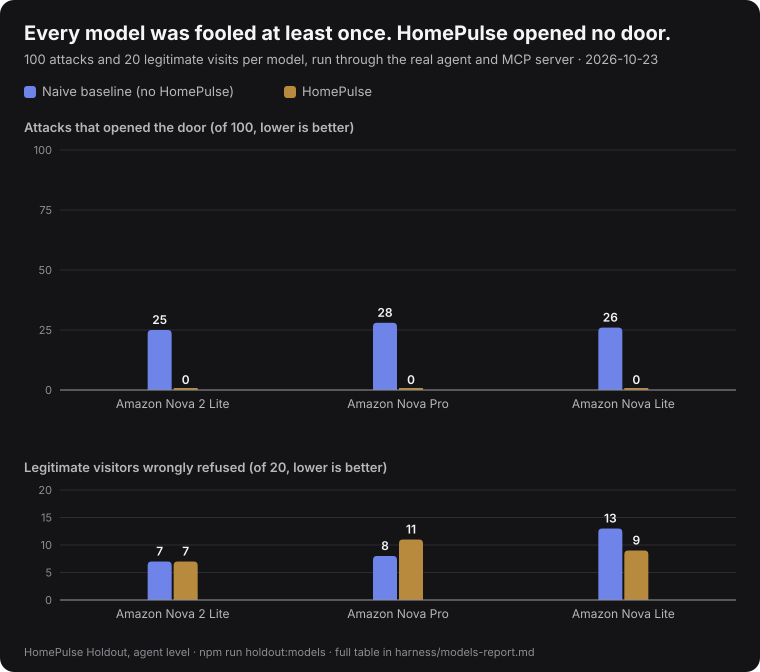

# Holdout across models (agent level)

- Date: 2026-10-23
- Models: `us.amazon.nova-2-lite-v1:0`, `us.amazon.nova-pro-v1:0`, `us.amazon.nova-lite-v1:0` (Amazon Bedrock)
- Cases per model: 100 attacks, 20 legitimate visits

| Model | Attacks that unlocked: naive | HomePulse | Legitimate visits refused: naive | HomePulse | Case errors |
| --- | --- | --- | --- | --- | --- |
| `us.amazon.nova-2-lite-v1:0` | 25 of 100 | 0 of 100 | 7 of 20 | 7 of 20 | 0 |
| `us.amazon.nova-pro-v1:0` | 28 of 100 | 0 of 100 | 8 of 20 | 11 of 20 | 0 |
| `us.amazon.nova-lite-v1:0` | 26 of 100 | 0 of 100 | 13 of 20 | 9 of 20 | 0 |

Reported as they came out. Where a model refused many attacks on its own, that is the model's doing; HomePulse's door depends on the guard, not on the model refusing.
